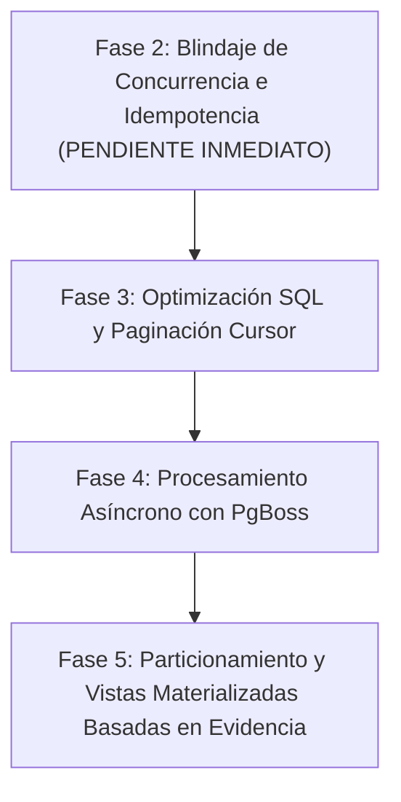

# 📋 Hoja de Ruta Pendiente — Arquitectura y Escalabilidad (pERP-2027)

> **Documento:** Tareas y Fases Pendientes de Implementación.  
> **Estado:** Fase 1 (Desacoplamiento Modular, RBAC y Paginación Defensiva) completada al 100%.  
> **Objetivo:** Ejecutar las Fases 2 a 5 para llevar el backend a grado enterprise.

---



---

## 🟡 Fase 2: Blindaje de Concurrencia e Idempotencia (Pendiente Inmediato)

### 1. Tabla de Operaciones Idempotentes en PostgreSQL
Crear e integrar la tabla para registrar claves de idempotencia en transacciones financieras:
```sql
CREATE TABLE IF NOT EXISTS idempotencia_operaciones (
    id UUID PRIMARY KEY DEFAULT gen_random_uuid(),
    empresa_id UUID NOT NULL,
    branch_id UUID NOT NULL,
    operacion VARCHAR(50) NOT NULL, -- 'VENTA', 'AJUSTE_STOCK', 'COBRO'
    idempotency_key VARCHAR(120) NOT NULL,
    request_hash VARCHAR(64) NOT NULL, -- SHA-256 del payload
    status VARCHAR(20) NOT NULL, -- 'PROCESANDO', 'COMPLETADO', 'FALLIDO'
    response_code INTEGER,
    response_body JSONB,
    created_at TIMESTAMPTZ DEFAULT NOW(),
    updated_at TIMESTAMPTZ DEFAULT NOW(),
    CONSTRAINT uq_idempotencia_empresa_clave UNIQUE (empresa_id, operacion, idempotency_key)
);
```

### 2. Comportamiento en los Endpoints de Cobro y Facturación
- Integrar la verificación de `idempotency_key` en `POST /api/ventas`.
- Si llega una petición con la misma clave y mismo hash:
  - Si está `COMPLETADO`: devolver inmediatamente el `response_body` y código previo sin re-procesar inventario ni duplicar comprobantes.
  - Si está `PROCESANDO`: responder `HTTP 425 Too Early`.
  - Si el payload difiere (`request_hash` distinto): responder `HTTP 409 Conflict`.

### 3. Orden Determinista Canónico para Prevenir Deadlocks
- Asegurar que todas las transacciones que involucren múltiples productos o presentaciones ordenen estrictamente los IDs antes de invocar `FOR UPDATE`:
```javascript
const sortedProdIds = [...new Set(items.map(i => i.producto_id))].sort()
```
- Replicar en:
  - Registro de venta y descarga de combos (`registrarVenta.service.js`).
  - Ajustes manuales y transferencias entre almacenes.

---

## ⚪ Fase 3: Optimización SQL y Paginación por Cursor

### 1. Agregación Atómica vía CTE SQL
Migrar las agregaciones y agrupaciones en memoria al motor PostgreSQL mediante subqueries/CTEs canónicos, evitando duplicaciones por producto cartesiano entre `stock_actual` y `presentaciones`:
```sql
WITH stock_consolidado_producto AS (
    SELECT 
        sa.producto_id,
        COALESCE(SUM(sa.saldo_actual), 0) AS saldo_total_base,
        MAX(sa.updated_at) AS ultimo_movimiento
    FROM stock_actual sa
    WHERE sa.branch_id = :branchId
      AND (:almacenId IS NULL OR sa.almacen_id = :almacenId)
    GROUP BY sa.producto_id
)
...
```

### 2. Paginación por Cursor
- Sustituir `OFFSET` por paginación indexada de cursor (`created_at`, `id`) en listados de alta frecuencia (ventas y kárdex) para mantener latencias < 20 ms con más de 100,000 registros.

---

## ⚪ Fase 4: Procesamiento Asíncrono con Colas (PgBoss)

Incorporar colas persistentes en PostgreSQL (`pg-boss`) para delegar tareas no críticas fuera del ciclo de vida de la petición HTTP:
- **Facturación Electrónica:** Generación de XML, firma digital y envío diferido a SUNAT/OSE con reintentos automáticos.
- **Reportes:** Exportación de Kárdex y libros contables masivos en PDF/Excel sin bloquear el Event Loop.
- **Sincronización:** Procesamiento de eventos en segundo plano para sucursales con intermitencia de red.

---

## ⚪ Fase 5: Particionamiento y Vistas Materializadas Basadas en Evidencia

- **Auditoría de Volumetría:** Monitorear el tamaño real en disco mediante `pg_total_relation_size`.
- **Particionamiento por Rango de Fechas:** Particionar mensualmente la tabla `stock` (Kárdex) únicamente cuando supere los 10 millones de filas para habilitar *Partition Pruning*.
- **Vistas Materializadas con Concurrencia:** Crear vistas materializadas (`REFRESH MATERIALIZED VIEW CONCURRENTLY`) para balances de stock consolidado y resúmenes contables mensuales.
