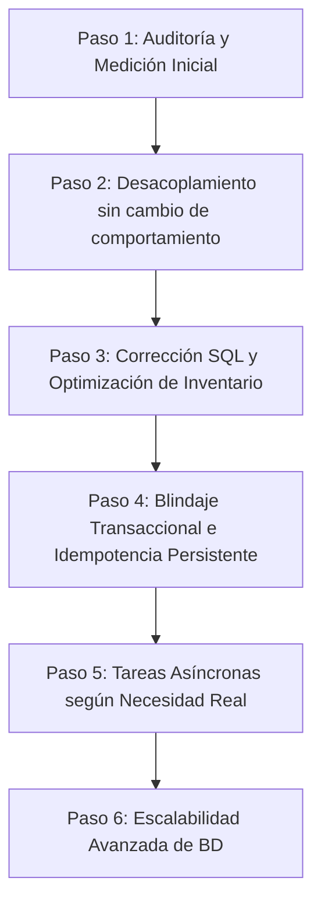

# 🏛️ Arquitectura Empresarial, Integridad Transaccional y Guía de Escalabilidad — pERP-2027 (Backend)

> **Documento:** Plan Maestro de Ingeniería, Concurrencia, Rendimiento y Hoja de Ruta de Refactorización Progresiva.  
> **Proyecto:** pERP-2027 · Backend (`BACK`)  
> **Stack Base:** Node.js (CommonJS) · Fastify v4 · Drizzle ORM · PostgreSQL 18 (`postgres.js`) · Vitest · PM2  
> **Estado:** Documento de Trabajo y Especificación Técnica Revisada  

---

## 🎯 1. Filosofía y Principio Rector

> **"Un ERP jamás sacrifica la exactitud contable ni la integridad transaccional por mejorar el tiempo de respuesta."**

La escala empresarial en un ERP multiempresa y multisucursal no se demuestra acumulando tecnologías complejas (Redis, workers, microservicios o particiones prematuras). Se demuestra cuando:
1. **El inventario y el Kárdex son 100% coherentes y auditables** en todo momento.
2. **El aislamiento multiempresa y multisucursal es hermético**, validado estrictamente en base de datos y lógica de dominio, nunca confiando en IDs enviados libremente por el frontend.
3. **Las operaciones concurrentes reales** (múltiples cajas cobrando, devoluciones, traslados y ajustes de stock simultáneos) no generan condiciones de carrera (*race conditions*), saldos negativos imprevistos ni bloqueos cruzados (*deadlocks*).
4. **El código es mantenible, desacoplado y testeable**, evitando "archivos monolíticos intocables" mediante refactorizaciones pequeñas, seguras y verificables que preserven el comportamiento de la API frente al cliente/POS.

---

## ⚠️ 2. Diagnóstico del Estado Actual

| Dimensión | Situación Actual Observada | Riesgo Real a Escala | Prioridad |
| :--- | :--- | :--- | :---: |
| **Arquitectura de Código** | Rutas monolíticas (ej. `stock.routes.js` con >1,100 líneas) que amalgaman transporte HTTP, validaciones, matemática de negocio y transacciones SQL. | Código frágil y de alto costo de mantenimiento. Imposibilita pruebas unitarias sin levantar el servidor HTTP Fastify. | 🔴 Alta |
| **Consultas de Inventario** | `GET /api/stock` descarga catálogos amplios a memoria Node.js y computa agregaciones con bucles `forEach`. | Cuello de botella en el Event Loop y consumo excesivo de RAM ante catálogos con miles de productos y presentaciones. | 🔴 Alta |
| **Operaciones Masivas** | `POST /carga-masiva` ejecuta consultas y bloqueos secuenciales dentro de un bucle `for` (N+1 queries con `FOR UPDATE`). | Tiempos de transacción prolongados (10-30s), manteniendo bloqueos de fila que congelan a los cajeros en vivo. | 🔴 Alta |
| **Paginación** | Ausencia de límites forzados en listados (`LIMIT` / `OFFSET` / cursores ausentes o no estandarizados). | Riesgo de fallas por memoria (*Out of Memory*) en clientes de bajos recursos (tablets POS, PCs de tienda). | 🟡 Media |
| **Idempotencia** | Operaciones de venta y cobranza expuestas a duplicidad ante microcortes de red o reintentos de cliente. | Riesgo de doble cargo contable o doble descuento de stock en tienda. | 🔴 Alta |

---

## 🧪 3. Metas de Rendimiento: Hipótesis Verificables (No Dogmas)

Las metas de rendimiento no son promesas estáticas garantizadas por una arquitectura, sino **hipótesis que deben contrastarse mediante pruebas de carga reales**:

* **Métricas Clave:** Medir latencias percentiles **p50, p95 y p99**, consumo de CPU/RAM del proceso Node.js, conexiones concurrentes activas en el pool de PostgreSQL y duración de retención de locks (`pg_locks`).
* **Condiciones de Prueba:** Las pruebas deben ejecutarse bajo condiciones de estrés representativas:
  - 10 a 50 cajas registradoras facturando concurrentemente.
  - Carga masiva de inventario (1,000 ítems) ejecutándose en paralelo a ventas activas.
  - Clientes ejecutándose en hardware limitado (POS táctiles con recursos modestos).

---

## 🔒 4. Integridad Transaccional, Inventario y Concurrencia

### 4.1 Granularidad de Datos y Prevención del Producto Cartesiano en SQL

> [!CAUTION]
> **Riesgo Crítico de Duplicación de Saldos:**  
> Si se realiza un `JOIN` directo entre `stock_actual` y `presentaciones` seguido de `SUM(sa.saldo_actual)`, cada fila de stock se multiplicará por la cantidad de presentaciones del producto, inflando falsamente el inventario en el ERP.

#### Modelo y Relaciones:
* **Entidad `stock_actual`:** Almacena el saldo físico vigente a nivel de `{ branch_id, almacen_id, producto_id, presentacion_id }` (y opcionalmente `lotes_id`).
* **Regla de Negocio:** El stock físico real del producto es la suma consolidada de sus unidades base en dicho almacén. La disponibilidad en cada presentación derivada (six pack, caja, display) se proyecta matemáticamente: `FLOOR(saldo_base_total / multiplica_por)`.

#### Consulta SQL Correcta (Agregación Atómica Previa vía CTE / Subquery):
Para garantizar que **cada fila de saldo se sume exactamente una sola vez**:

```sql
WITH stock_consolidado_producto AS (
    -- Paso 1: Agregación atómica por producto y almacén (SIN JOIN con presentaciones)
    SELECT 
        sa.producto_id,
        COALESCE(SUM(sa.saldo_actual), 0) AS saldo_total_base,
        MAX(sa.updated_at) AS ultimo_movimiento
    FROM stock_actual sa
    WHERE sa.branch_id = :branchId
      AND (:almacenId IS NULL OR sa.almacen_id = :almacenId)
    GROUP BY sa.producto_id
),
stock_por_presentacion_individual AS (
    -- Paso 2: Saldo registrado específicamente en la fila de la presentación
    SELECT 
        sa.producto_id,
        sa.presentacion_id,
        sa.saldo_actual AS saldo_fila_presentacion
    FROM stock_actual sa
    WHERE sa.branch_id = :branchId
      AND (:almacenId IS NULL OR sa.almacen_id = :almacenId)
)
SELECT 
    p.id AS producto_id,
    p.codigo,
    p.nombre AS producto_nombre,
    p.stock_minimo,
    p.es_combo,
    pr.id AS presentacion_id,
    pr.nombre AS presentacion_nombre,
    COALESCE(pr.multiplica_por, 1) AS multiplica_por,
    -- Saldo consolidado exacto en unidad base
    COALESCE(scp.saldo_total_base, 0) AS saldo_producto_total,
    -- Saldo calculado disponible para esta presentación
    FLOOR(COALESCE(scp.saldo_total_base, 0) / NULLIF(COALESCE(pr.multiplica_por, 1), 0)) AS saldo_actual_presentacion,
    COALESCE(spp.saldo_fila_presentacion, 0) AS saldo_movimiento_presentacion
FROM productos p
INNER JOIN presentaciones pr ON pr.producto_uuid = p.id
LEFT JOIN stock_consolidado_producto scp ON scp.producto_id = p.id
LEFT JOIN stock_por_presentacion_individual spp ON spp.producto_id = p.id AND spp.presentacion_id = pr.id
WHERE (p.empresa_id = :empresaId OR p.empresa_id IS NULL)
  AND (:activo IS NULL OR p.activo = :activo)
  AND (:categoriaId IS NULL OR p.categoria = :categoriaId)
ORDER BY p.es_combo DESC, p.nombre ASC, pr.multiplica_por ASC
LIMIT :limit OFFSET :offset;
```

---

### 4.2 Control de Concurrencia, Bloqueos Canónicos y Prevención de Deadlocks

En operaciones masivas (cargas de stock, inventarios físicos, reinicios), **no se debe utilizar `Promise.all` descuidado mezclando lecturas con `FOR UPDATE`**. Si dos transacciones intentan bloquear los mismos productos en diferente secuencia, PostgreSQL abortará una con error `40P01 (deadlock detected)`.

#### Reglas de Concurrencia Enterprise:
1. **Orden Determinista Canónico:**  
   Siempre ordenar los identificadores de productos antes de invocar `FOR UPDATE`. De este modo, todas las operaciones del sistema (ventas, compras, ajustes) adquieren los locks en el mismo orden físico exacto:
   ```javascript
   const sortedProdIds = [...new Set(items.map(i => i.producto_id))].sort()
   ```
2. **Restricción de Integridad Única en Base de Datos:**  
   Garantizar a nivel de motor SQL la unicidad del saldo para evitar filas duplicadas huérfanas:
   ```sql
   CREATE UNIQUE INDEX IF NOT EXISTS uq_stock_actual_almacen_prod_pres 
   ON stock_actual (branch_id, almacen_id, producto_id, presentacion_id);
   ```
3. **Fragmentación en Lotes (Chunking) y Transacciones Ultra-cortas:**  
   Fragmentar operaciones masivas en lotes de **100 a 200 ítems**. Cada transacción debe abrirse, ejecutar el cálculo en memoria, persistir el batch y cerrarse en menos de **50 ms**, liberando de inmediato las filas para las cajas registradoras.
4. **Ámbito Estricto de Bloqueo por Sucursal y Almacén:**  
   Las cláusulas de bloqueo deben incluir invariablemente `branch_id` y `almacen_id`. Un inventario en el Almacén 1 jamás debe bloquear los productos del Almacén 2.
5. **Reintentos Automáticos ante Conflictos de Concurrencia:**  
   Implementar reintentos con *backoff exponencial* controlado (máximo 3 intentos) para capturar errores transitorios de serialización (`40001`) o bloqueos temporales.

---

### 4.3 Idempotencia Persistente para Ventas y Cobros

> [!IMPORTANT]
> La idempotencia no puede depender de una ventana volátil de 2 minutos en memoria. Una desconexión prolongada en un punto de venta rural o un reintento tardío del navegador no deben duplicar una venta.

#### Diseño de Idempotencia de Grado Financiero:
1. **Tabla de Operaciones Idempotentes en PostgreSQL:**
   ```sql
   CREATE TABLE idempotencia_operaciones (
       id UUID PRIMARY KEY DEFAULT gen_random_uuid(),
       empresa_id UUID NOT NULL,
       branch_id UUID NOT NULL,
       operacion VARCHAR(50) NOT NULL, -- 'VENTA', 'AJUSTE_STOCK', 'COBRO'
       idempotency_key VARCHAR(120) NOT NULL,
       request_hash VARCHAR(64) NOT NULL, -- SHA-256 del payload recibido
       status VARCHAR(20) NOT NULL, -- 'PROCESANDO', 'COMPLETADO', 'FALLIDO'
       response_code INTEGER,
       response_body JSONB,
       created_at TIMESTAMPTZ DEFAULT NOW(),
       updated_at TIMESTAMPTZ DEFAULT NOW(),
       CONSTRAINT uq_idempotencia_empresa_clave UNIQUE (empresa_id, operacion, idempotency_key)
   );
   ```
2. **Comportamiento ante Reintentos:**
   * **Misma clave y mismo hash:** Si la operación ya fue `COMPLETADA`, se retorna inmediatamente el `response_body` original con el mismo código HTTP, sin tocar inventario ni generar nuevos comprobantes.
   * **Misma clave pero diferente payload (`request_hash`):** Se rechaza con `HTTP 409 Conflict` (intento de reutilización indebida de clave con datos distintos).
   * **Estado `PROCESANDO`:** Si llega una petición idéntica mientras la primera aún se está ejecutando, se responde `HTTP 425 Too Early` o `HTTP 409` solicitando esperar el resultado de la transacción en curso.

---

### 4.4 Criterio Técnico sobre Particionamiento de Tablas

* **No particionar preventivamente solo por superar 5 millones de filas:** El particionamiento agrega sobrecarga operativa en DDL, dificulta la definición de claves foráneas globales y exige que las claves primarias contengan la clave de partición (`PRIMARY KEY (id, created_at)`).
* **Estrategia Correcta:**
  1. Primero, optimizar índices compuestos (`btree`, índices parciales con `WHERE activo = true`).
  2. Evaluar el tamaño físico en disco de la tabla e índices (`pg_total_relation_size`).
  3. Particionar únicamente si las consultas de negocio filtran consistentemente por el criterio de partición (ej. consultas de Kárdex estrictamente por rango mensual) permitiendo que el planificador de PostgreSQL aplique *Partition Pruning* efectivo.

---

## 🏛️ 5. Arquitectura por Dominios (Vertical Slice Architecture)

En lugar de una división puramente técnica horizontal, el ERP se estructura por contextos delimitados (*Bounded Contexts*):

```text
BACK/src/modules/
├── inventario/                    # Contexto: Stock, Kárdex, Presentaciones, Almacenes
│   ├── inventario.routes.js        # Declaración pura de rutas Fastify y schemas
│   ├── controllers/
│   │   └── inventario.controller.js # Mapeo HTTP (req/res, status codes)
│   ├── services/
│   │   ├── stock.service.js        # Reglas de negocio: consolidación de saldos y factores
│   │   ├── reinicioStock.service.js # Caso de uso transaccional: reinicio masivo
│   │   └── cargaMasiva.service.js   # Caso de uso transaccional: inventario por lotes
│   └── repositories/
│       ├── stock.repository.js     # Consultas Drizzle ORM sobre stock_actual
│       └── kardex.repository.js    # Inserciones y consultas históricas sobre stock
│
├── ventas/                        # Contexto: Facturación, Boletas, Preventas, Cajas
├── clientes/                      # Contexto: Clientes, RUC/DNI, Líneas de crédito
├── contabilidad/                  # Contexto: Asientos contables, Libros electrónicos
└── sync/                          # Contexto: Sincronización Server-to-Server
```

---

## 🚀 6. Orden de Ejecución Pragmático (Paso a Paso)

Para no desestabilizar la aplicación en producción, la refactorización debe ejecutarse en fases ordenadas y verificables:



### Paso 1: Auditoría y Medición Inicial
* Medir tiempos de respuesta actuales de `GET /api/stock`, `POST /ajuste` y `POST /carga-masiva`.
* Revisar planes de ejecución (`EXPLAIN ANALYZE`) e índices existentes en `stock_actual` y `stock`.

### Paso 2: Desacoplamiento Estructural (Sin alterar comportamiento)
* Extraer controladores y servicios de `stock.routes.js` a `src/modules/inventario/`.
* Verificar que la API responda exactamente la misma estructura JSON al frontend existente.

### Paso 3: Corrección de Inventario y Batching
* Implementar la consulta SQL con CTEs de agregación atómica previa para eliminar el riesgo de duplicación de saldos.
* Agregar orden canónico (`.sort()`) en bloqueos de fila para erradicar *deadlocks*.
* Implementar paginación estándar (`limit`, `offset` / cursor).

### Paso 4: Blindaje Transaccional y Auditoría
* Crear tabla persistente de `idempotencia_operaciones` para ventas y movimientos.
* Asegurar que todo movimiento de stock guarde su documento de auditoría verificable en Kárdex.

### Paso 5: Procesamiento Asíncrono Selectivo
* Incorporar colas de trabajo en segundo plano (**PgBoss** sobre PostgreSQL sin añadir dependencias externas de infraestructura) para reportes pesados, importaciones masivas y comunicación SUNAT.

### Paso 6: Escalabilidad Avanzada basada en Evidencia
* Monitorear el crecimiento en disco. Si las métricas lo justifican, evaluar vistas materializadas para reportes o particionamiento mensual de Kárdex.
